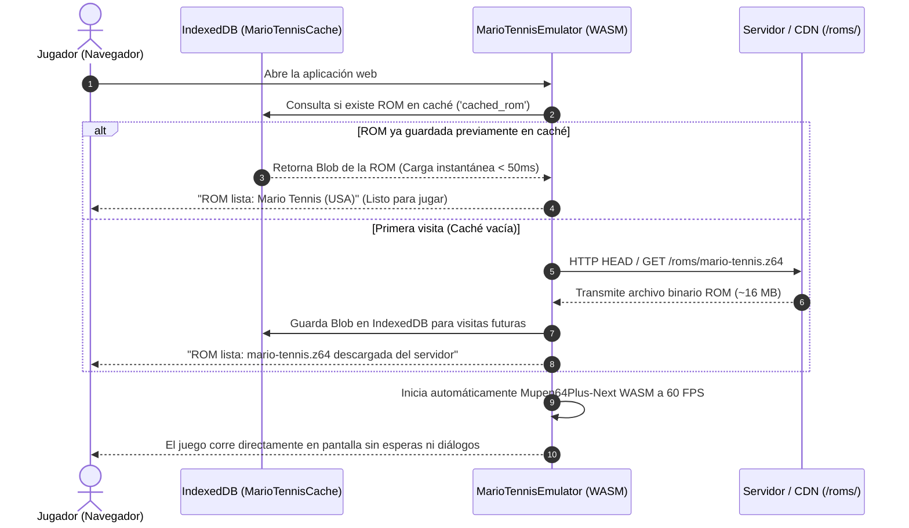

# 🎾 Mario Tennis 64 - Web Port & Online Netplay
## Documento de Contexto Técnico y Arquitectura del Proyecto

> **Versión**: 1.0.0  
> **Estado**: En desarrollo activo / Producción  
> **Licencia**: MIT  
> **Plataforma Objetivo**: Navegadores Web Modernos (PC, Mac, Linux, Dispositivos Móviles)  
> **Premisa Fundamental**: **Zero-Client ROM Setup** — La ROM se aloja y sirve directamente desde el servidor; el usuario final **no** necesita poseer, descargar previamente ni subir ningún archivo ROM a su PC para jugar.

---

## 1. Visión General del Proyecto

Este proyecto es una plataforma web completa de emulación y juego multijugador en tiempo real para **Mario Tennis (Nintendo 64)**. Su propósito es ofrecer una experiencia **"Plug & Play"** inmediata: cualquier persona puede entrar a la URL del sitio web, hacer clic en jugar y disfrutar del juego a **60 FPS fluidos**, ya sea en solitario, en modo cooperativo local o enfrentándose a un amigo a través de internet mediante tecnología **WebRTC P2P**.

### Principios de Diseño:
1. **Acceso Inmediato (Zero-Barrier)**: El usuario entra al navegador y juega al instante. No hay formularios de registro, ni emuladores externos que instalar, ni necesidad de buscar o subir archivos `.z64` / `.n64`.
2. **ROM Centralizada en Servidor**: La ROM oficial del juego se encuentra alojada en el servidor (o CDN / almacenamiento en la nube). El cliente web la descarga e inicializa de forma completamente transparente.
3. **Caché Inteligente del Lado del Cliente**: Para no sobrecargar el servidor ni consumir ancho de banda en cada visita, la ROM se almacena en el navegador mediante **IndexedDB**. Tras la primera descarga, la carga es prácticamente instantánea (<50 ms).
4. **Multijugador Online de Latencia Ultra-Baja**: Implementación de **Remote Play Together** vía WebRTC, evitando desincronizaciones entre emuladores y permitiendo que el segundo jugador se una sin siquiera tener que descargar la ROM completa.
5. **Ligero y de Alto Rendimiento**: Desarrollado con tecnologías web nativas (Vanilla JS, CSS3, HTML5, WebAssembly), sin frameworks pesados (React, Angular, Vue) que penalicen el rendimiento o consuman memoria innecesaria.

---

## 2. Estrategia de Alojamiento y Entrega de la ROM (Server-Hosted ROM)

### 2.1. Arquitectura de Distribución
En lugar de depender de que el usuario arrastre un archivo `.z64` a la pantalla, el sistema está diseñado para que el servidor web suministre la ROM:



### 2.2. Ventajas del Enfoque Server-Hosted
- **Experiencia de Usuario Inmediata (Zero-Prompt)**: Elimina completamente cualquier cuadro de carga o diálogo de selección de archivo. El usuario no interactúa con ningún dropzone ni selector.
- **Acceso Multiplataforma**: Los usuarios de Smart TVs, iPads, smartphones y PC juegan directamente sin lidiar con exploradores de archivos.
- **Ahorro de Ancho de Banda**: Gracias a la integración con `IndexedDB` en `js/emulator.js`, cada usuario solo descarga la ROM del servidor **una única vez**. Las visitas posteriores se ejecutan localmente desde el almacenamiento offline del navegador.

---

## 3. Pila Tecnológica (Tech Stack)

| Capa | Tecnología | Función Principal |
| :--- | :--- | :--- |
| **Frontend Core** | HTML5 semántico | Estructura de la aplicación, viewport del emulador y controles accesibles |
| **Estilos & UI** | Vanilla CSS3 | Diseño retro-arcade moderno, temas visuales por tipo de cancha, soporte de CRT scanlines y adaptabilidad móvil |
| **Lógica Cliente** | JavaScript (ES6+ modular) | Coordinación de componentes sin dependencias de compilación ni bundlers pesados |
| **Motor de Emulación** | **WebAssembly (WASM)** / Mupen64Plus-Next | Ejecución precisa del hardware de N64 en el hilo del navegador a 60 FPS |
| **Capa de Emulador** | EmulatorJS CDN | Inyección y control del runtime WASM, mapeo de memoria y canvas WebGL |
| **Persistencia Local** | HTML5 IndexedDB API | Almacenamiento en disco local de la ROM descargada (`MarioTennisCache`) |
| **Multijugador Online** | **WebRTC + PeerJS** | Transmisión de video del canvas a 60 FPS y canal de datos binario para mandos P2P |
| **Audio** | Web Audio API nativa | Generador procedural de efectos sonoros (raquetazos, fanfarrias, navegación) sin archivos MP3/WAV externos |
| **Mandos Físicos** | HTML5 Gamepad API | Detección automática y mapeo de mandos (Xbox, PlayStation, Switch Pro, USB) |
| **Controles Móviles** | Virtual Touch Controller (Touch API) | Joystick analógico virtual flotante y botones de acción en pantalla |
| **Servidor Web** | Node.js nativo (`http`, `fs`, `path`) | Servidor estático de alto rendimiento con cabeceras de aislamiento COOP/COEP |

---

## 4. Arquitectura de Módulos del Sistema

```
Mario-Tenis-Web-Port/
├── index.html                   # Interfaz de usuario completa, canvas, HUD y tabs
├── server.js                    # Servidor HTTP local con cabeceras WebAssembly
├── package.json                 # Metadatos del proyecto y comandos npm
├── css/
│   └── style.css                # Sistema de diseño completo (paletas, arena, HUD, responsive)
├── js/
│   ├── app.js                   # Coordinador central de eventos UI, tabs, toasts y estado
│   ├── config.js                # Configuraciones globales, roster de personajes, pistas y protocolos
│   ├── emulator.js              # Descarga de ROM desde servidor, IndexedDB y montaje de WASM
│   ├── netplay.js               # Motor WebRTC P2P (Host vs Guest, streaming de canvas y DataChannels)
│   ├── gamepad.js               # Gestor de mandos físicos (Xbox, PS4/PS5, Switch) con auto-polling
│   ├── virtual-controller.js    # Mando táctil en pantalla para pantallas móviles/tablets
│   └── audio.js                 # Sintetizador procedural de audio con Web Audio API
└── roms/
    ├── Mario Tennis (USA).z64   # Archivo ROM oficial de 16MB suministrado por el servidor
    └── mario-tennis.z64         # Enlace simbólico para resolución de rutas
```

### 4.1. Descripción Detallada de Archivos Clave

#### `server.js` (Servidor Web & Aislamiento WASM)
- Servidor HTTP nativo sin paquetes externos de npm.
- Inyecta cabeceras críticas de seguridad requeridas por los navegadores modernos para habilitar `SharedArrayBuffer` y ejecución multinúcleo en WebAssembly:
  - `Cross-Origin-Opener-Policy: same-origin`
  - `Cross-Origin-Embedder-Policy: credentialless`
  - `Access-Control-Allow-Origin: *`
- Proporciona streaming continuo de archivos binarios grandes (`.z64`, `.wasm`).

#### `js/emulator.js` (Motor de Emulación & Carga de ROM)
- Gestiona la conexión con `IndexedDB` (`MarioTennisCache`).
- Al iniciar, invoca `checkCachedRom()`: si no existe en caché local, ejecuta `checkLocalServerRom()` para realizar la descarga automática vía `fetch` desde `/roms/mario-tennis.z64`.
- Configura las variables globales de EmulatorJS (`window.EJS_gameUrl`, `window.EJS_core = 'n64'`) e inicializa el runtime WebAssembly en `#emulator-game-container`.
- Supervisa la aparición del elemento `<canvas>` para conectarlo automáticamente al stream de video de Netplay.

#### `js/netplay.js` (Multijugador Online P2P - Remote Play Together)
- **Host (Jugador 1)**:
  - Descarga la ROM del servidor y ejecuta la instancia activa del emulador.
  - Captura el stream de video del canvas a 60 FPS (`canvas.captureStream(60)`) y el stream de audio.
  - Se registra en la red de señalización de PeerJS generando un código numérico único de sala (ej. `7842`).
  - Transmite el video y el audio directamente al Invitado.
  - Recibe los paquetes binarios de control del Invitado a través de un `RTCDataChannel` sin retardo y los reenvía al Puerto de Mando 2 del emulador.
- **Invitado (Jugador 2)**:
  - Se une mediante el código de sala o enlace compartido (`?room=7842`).
  - **No necesita descargar la ROM**: Reproduce el flujo de video/audio en el elemento `<video id="guest-remote-video">` en tiempo real.
  - Captura sus pulsaciones de teclado o mando físico a 60 Hz y las envía por el canal WebRTC al Host.
  - **Resultado**: Cero problemas de sincronización de emuladores, latencia de entrada mínima (<30-50 ms en conexiones estándar) y juego fluido garantizado.

#### `js/config.js` (Configuración del Sistema)
- Lista de servidores STUN de Google y Cloudflare para atravesar NATs y firewalls de red.
- Roster completo de los 10 personajes del juego con sus atributos (Equilibrado, Técnica, Velocidad, Potencia, Defensa).
- Ficha técnica de las 5 canchas de tenis (Dura, Tierra Batida, Hierba, Moqueta, Pista de Bowser) con su velocidad y altura de bote.
- Mapeo de teclas por defecto para Jugador 1 y Jugador 2.

#### `js/gamepad.js` (Compatibilidad con Mandos)
- Soporte para la Gamepad API de HTML5.
- Asignación inteligente: el primer mando conectado se asigna al Jugador 1; el segundo mando se asigna al Jugador 2 (para juego local de dos jugadores en la misma PC).
- Deadzone configurada en `0.22` para evitar derivas del joystick analógico.

#### `js/audio.js` (Efectos Procedurales)
- Generación de sonidos mediante osciladores y filtros de la Web Audio API nativa.
- Incluye efectos de raquetazo, servicio potente, bote en la pista, silbato de arbitraje, fanfarria de victoria y efectos de navegación de la interfaz, sin requerir la descarga de archivos de audio adicionales.

---

## 5. Requisitos de Rendimiento y Filosofía de Eficiencia

Siguiendo una estricta política de optimización y mínimo consumo de recursos del sistema:
- **Cero dependencias innecesarias**: No se usan Webpack, Vite, Babel ni frameworks pesados para el frontend; el código se sirve directamente al navegador con tiempo de inicio inmediato.
- **Bajo impacto de CPU/GPU**: La emulación WebAssembly y el renderizado WebGL aprovechan la aceleración por hardware de la GPU sin saturar los núcleos de CPU.
- **Ahorro de memoria RAM**: La ROM reside en memoria solo durante la sesión de juego; el almacenamiento persistente aprovecha la cuota de IndexedDB sin copias redundantes.

---

## 6. Guía de Ejecución y Despliegue

### 6.1. Ejecución Local (Desarrollo y Pruebas)
```bash
# 1. Posicionarse en el directorio del proyecto
cd /home/fkhalil/Desktop/Proyectos/Mario-Tenis-Web-Port

# 2. Iniciar el servidor local
npm start
# o alternativamente:
node server.js

# 3. Abrir en el navegador preferido
# http://localhost:3000
```

### 6.2. Despliegue en Producción
Para desplegar la aplicación en un servidor web público:
1. **Servidor con Node.js / VPS / Docker**:
   - Clonar el repositorio y ejecutar `node server.js` detrás de un proxy inverso como Nginx o Caddy.
   - Asegurar que la configuración del servidor web mantenga las cabeceras `Cross-Origin-Opener-Policy: same-origin` y `Cross-Origin-Embedder-Policy: credentialless`.
2. **Servidores Estáticos / Serverless (Cloudflare Pages, Vercel, Netlify)**:
   - Configurar las reglas de cabeceras HTTP (`_headers` o `vercel.json`) para incluir COOP/COEP.
   - Alojar el archivo de la ROM en un bucket de almacenamiento S3 / Cloudflare R2 con enlace público o servirlo directamente en la carpeta estática `/roms/`.

---

## 7. Hoja de Ruta y Mejoras Planificadas (Roadmap)

- [x] Servidor estático con cabeceras COOP/COEP para WASM.
- [x] Detección y carga automática de la ROM desde `/roms/`.
- [x] Caché persistente en IndexedDB para evitar descargas repetidas.
- [x] Netplay WebRTC P2P funcional con audio y video en tiempo real.
- [x] Soporte de mandos USB/Bluetooth y teclado dual.
- [x] Mando táctil virtual para dispositivos móviles.
- [ ] **Barra de Progreso de Descarga en el Banner**: Mostrar porcentaje (0% a 100%) durante la descarga inicial de la ROM desde el servidor para informar visualmente al usuario con conexiones lentas.
- [ ] **Soporte de ROMs Comprimidas (.zip)**: Permitir que el servidor aloje `mario-tennis.zip` (~11 MB) y descomprimir en cliente vía WebAssembly / JSZip para reducir la transferencia de datos en un 30%.
- [ ] **Lobby Público de Partidas**: Lista de salas activas en tiempo real para emparejamiento aleatorio (matchmaking) sin necesidad de compartir códigos manualmente.
